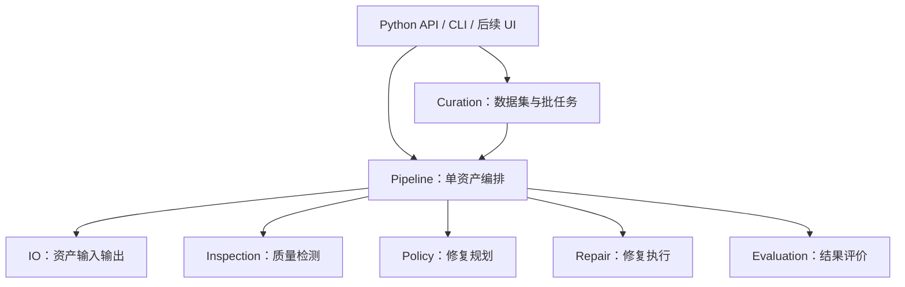

# MeshEngineer 顶层架构

状态：顶层设计已确认，当前仅建立文档与目录骨架。

确认日期：2026-11-05。

依据：本地目标资料 `template/aim.rtf`（不随 Git 提交）及本轮架构讨论；开发审批与验证规则见 [AGENTS.md](../AGENTS.md)。

本文记录模块职责、主要调用方向、外置数据处理方式及其目录映射。具体接口、内部文件拆分和技术选型在后续工程初始化方案中确定。

## 1. 范围

v0.1 面向静态三角网格，覆盖资产导入、质量检测、修复规划与执行、复检评价和数据集整理。动画、骨骼、复杂 CAD 与完整场景处理属于后续范围。

系统提供可复用的 Python 能力及 CLI 入口。Web UI、渲染、VLM 评价、Repair-as-Code 和学习型策略作为后续可选扩展，不作为初始核心流程的强制依赖。

## 2. 顶层模块

| 模块 | 职责 | 职责边界 |
| --- | --- | --- |
| Core | 定义统一资产模型、资产引用、质量规范、报告、修复计划及公共接口 | 提供公共定义；不承担路由、流程调度或具体后端实现 |
| IO | 访问外置资产，读取和导出几何、材质、纹理及元数据 | 文件访问及格式处理；内部适配方式待导入模块设计时确定 |
| Inspection | 检测资产状态与质量问题，生成结构化检测结果 | 检测结果作为规划与评价的输入 |
| Policy | 根据检测结果和 Quality Profile，决定修复操作、参数、顺序及停止或跳过条件 | 生成修复计划；修复执行由 Repair 承担 |
| Repair | 实现修复算子及其执行，适配具体几何处理后端 | 执行选定操作；修复策略由 Policy 决定 |
| Evaluation | 比较处理前后的资产与检测结果，评价有效性、保真度和成本，判断结果是否可接受 | 返回评价结论；流程推进和回退由 Pipeline 管理 |
| Pipeline | 编排单资产处理流程，管理执行状态、复检、跳过、过程记录、输出保留和回退 | 单资产执行；批任务管理由 Curation 承担 |
| Curation | 管理资产清单、批处理、进度、质量筛选、失败记录、重试和数据集导出 | 通过同一条 Pipeline 处理单个资产，复用单资产处理逻辑 |

CLI 是上述能力的调用入口，后续 UI 也复用相同的 Python 能力。

### 调用关系



上图表示主要调用关系，不表示执行顺序。Core 为各层提供共同的数据模型和接口定义，不是流程中的中转步骤。

### 依赖原则

- 其他模块依赖 Core 的公共定义；Core 不反向依赖处理模块、Pipeline 或 Curation。
- Core 的公共模型与接口保持与具体网格处理后端解耦。具体后端对象和调用封装在处理模块内部。
- Pipeline 结合 Policy 的计划和 Evaluation 的结论推进流程；Curation 管理批任务，调用 Pipeline 复用单资产处理逻辑。
- CLI 与未来 UI 调用框架能力，具体入口接口在后续方案中确定。

## 3. 单资产处理流程

阶段职责保持稳定，修复步骤由策略配置：

```text
导入 → 检测 → 修复规划 → 修复执行 → 复检与评价 → 输出
```

1. IO 根据资产引用访问内容，导入统一资产对象及相关元数据。
2. Inspection 检测当前资产，形成后续规划和比较的依据。
3. Policy 根据检测结果与 Quality Profile 形成修复计划；合格资产可以跳过修复。
4. Repair 执行计划中的算子，记录执行结果。
5. Pipeline 协调再次检测与 Evaluation，比较处理前后的质量、保真度及成本。
6. Pipeline 根据结论保留输出或执行回退，并返回结构化处理结果；批量运行时由 Curation 汇总状态与报告。

可配置项包括算子、参数、顺序和跳过条件。不同资产可以采用不同修复方案，阶段骨架不意味着每个资产都执行相同的修复序列。

## 4. 外置数据与按需加载

### 资产引用与资产对象

- **AssetRef（资产引用）**：资产的轻量定位信息，包含资产标识、所属数据源及可解析的位置。具体字段和位置表达方式待接口设计确定。
- **Asset（资产对象）**：承载当前单资产处理所需的几何、材质、纹理和相关元数据。其表示与后端适配方式待后续设计确定。

Curation 通过 AssetRef 调度任务，管理清单、状态和报告。Pipeline 处理某个资产时，再通过 IO 按需加载内容；处理完成后保存结果并释放资源。

### 存储位置

真实数据集、缓存和处理结果可以位于外置硬盘、服务器挂载盘或云端，各自的位置由配置指定。配置目录保存配置内容，真实数据不以项目源码目录为存储边界。

仓库中的 `tests/fixtures/` 保存小型、可复现的测试资产及关联文件。Objaverse 等大规模数据集保持外置，批处理通过清单和引用逐个或分批访问，避免将全部网格载入内存。

原始资产予以保留，处理结果另行输出。处理记录需要保留输入来源与哈希、算子及参数、质量指标和输出位置，使结果可追溯、可复现；具体记录结构在后续接口设计中确定。

当前仅确认外置数据的架构原则，本地存储、云端访问、下载和缓存的实现范围尚待确定。此前讨论过的独立 `sources/` 模块仍是候选内部划分，不属于本轮确认的顶层目录。

## 5. 运行时失败范围

| 情况 | 处理方式 |
| --- | --- |
| 单个文件损坏、资产修复失败或质量不达标 | Pipeline 返回结构化结果及适用的回退信息；Curation 记录后继续处理其他资产 |
| 配置无效、必要依赖缺失等导致整批无法执行 | 尽早停止批次，明确报告原因 |

单资产回退由 Pipeline 管理；批任务重试和失败管理由 Curation 承担。具体重试规则、检查点和回退粒度在后续方案中细化。

上述规则适用于程序运行时的数据处理。开发阶段回归测试失败时，仍按 AGENTS.md 暂停调整、分析反馈问题，并在新方案获得用户确认后继续。

## 6. 目录映射

```text
MeshEngineer/
├── AGENTS.md
├── .agents/                        # 本地开发技能及安装记录；Git 忽略
├── docs/                           # 项目架构与各模块的正式设计文档
│   └── architecture.md             # 当前顶层架构基线
├── template/                       # 开发过程资料与临时文件；Git 忽略
│   ├── aim.rtf                     # 本地目标资料
│   └── research/                   # 已有调研资料
├── configs/                        # 配置文件位置；具体配置方案待定
├── src/
│   └── meshengineer/
│       ├── __init__.py
│       ├── core/                   # 公共数据模型与接口
│       ├── io/                     # 资产访问、导入与导出
│       ├── inspection/             # 质量检测
│       ├── policy/                 # 修复规划
│       ├── repair/                 # 修复算子与执行
│       ├── evaluation/             # 结果评价
│       ├── pipeline/               # 单资产流程编排
│       ├── curation/               # 数据集与批任务管理
│       └── cli/                    # 命令行入口
└── tests/
    ├── core/
    ├── io/
    ├── inspection/
    ├── policy/
    ├── repair/
    ├── evaluation/
    ├── pipeline/
    ├── curation/
    ├── cli/
    └── fixtures/                   # 小型测试资产与关联文件
```

源码各包目前仅包含说明职责的 `__init__.py`；测试与配置目录使用 `.gitkeep` 保留空目录。它们表示已确认的职责位置，不代表相应功能已经实现，也不代表已有可执行的回归测试集。

## 7. 后续设计事项

接下来先讨论 IO 导入模块，再形成可执行的工程初始化方案，明确：

- 首个导入里程碑的格式、资产范围、关联资源和错误处理要求。
- Core 中相关数据模型及公共接口的具体定义。
- IO 内部的资产访问、格式解析及后端适配划分。
- Python 版本、依赖、开发工具链、包配置和 CLI 入口。
- 回归案例、验收约束、类型检查与测试命令。

上述细节在后续讨论中逐项明确，形成方案后由用户批准，再开始实现。本轮交付限于顶层设计文档和文件层级骨架。
